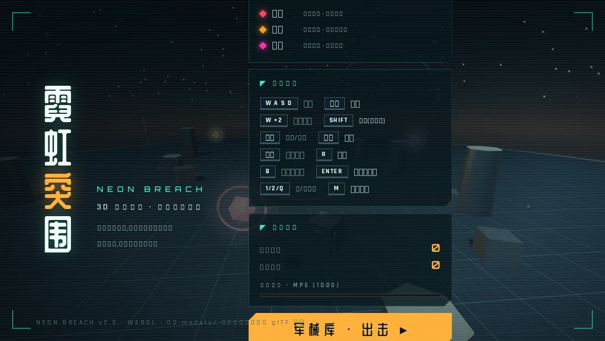
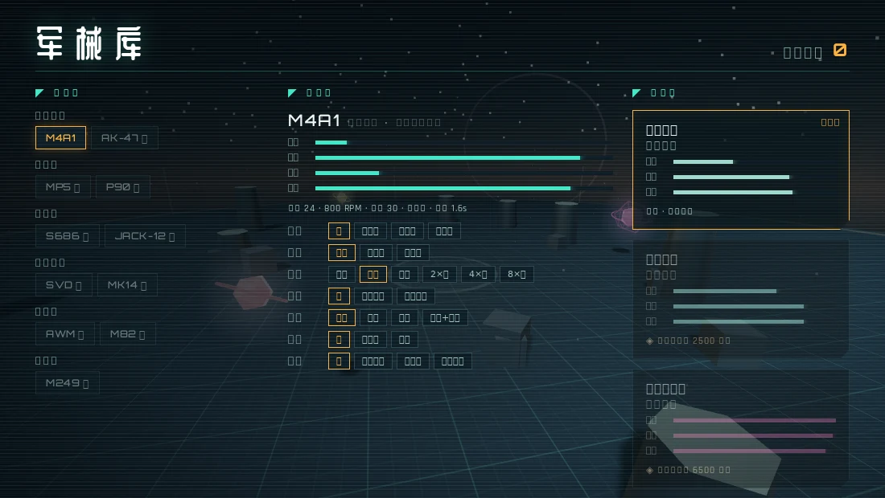
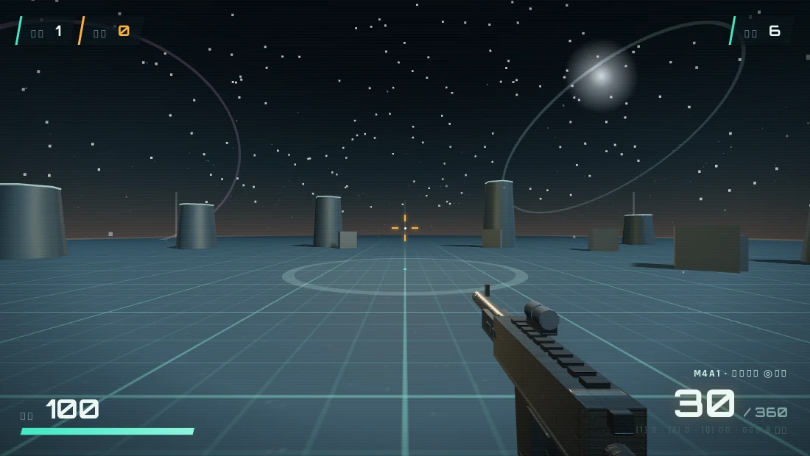
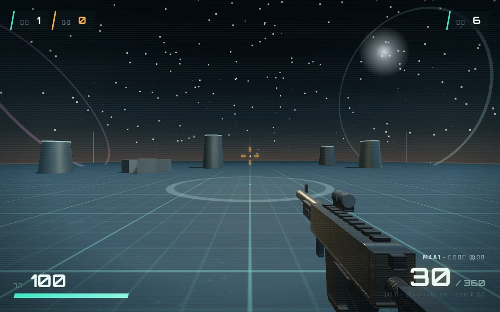

<p align="center">
  
</p>

<h1 align="center">霓虹突围 · NEON BREACH</h1>

<p align="center">
  <b>3D 生存射击 · 无尽波次协议</b><br>
  three.js r128 · WebGL · 单文件 <code>index.html</code> · 中文 UI
</p>

> 深空哨站失守，无人机群正在逼近。撑过一波又一波的敌机突袭，攒下积分，解锁名枪与配件。

## 特性

- **无尽波次协议** —— 敌机数量、种类、防区半径随波次逐级升级，波与波之间手动开波，节奏自己掌控
- **11 把枪械 + 3 把战术刀** —— 突击步枪 / 冲锋枪 / 霰弹枪 / 射手步枪 / 狙击枪 / 轻机枪，全部带独立数值（伤害、RPM、弹匣、后座、换弹）
- **7 槽位深度改装** —— 枪口、枪管、瞄具（红点 / 全息 / 2×/4×/8×）、枪托、弹匣、下挂、握把，按枪独立存档，波间改装台即时生效
- **连击倍率经济** —— 3 秒内连续击杀维持连击，倍率最高 ×4；累计积分跨局解锁武器与刀具
- **三类敌机** —— 高速冲撞的「猎刃」、中距压制的「蜂刺」、重甲炮击的「堡垒」，波次越高越强
- **程序化音效** —— Web Audio 实时合成枪声 / 刀声 / 爆炸，104 BPM 电子 BGM（`M` 键开关），零音频文件
- **支持真实枪模** —— 放入 `models/*.glb` 即可导入 glTF 枪械模型，加载失败自动回退程序化枪模
- **轻量单文件** —— 游戏本体就是一个 `index.html`（约 111 KB），localStorage 自动存档

## 截图

| 军械库 · 配装 | 战斗视角 |
| --- | --- |
|  |  |

<p align="center">
  
</p>

## 快速开始

需要联网（three.js 与字体走 CDN，多级回退）。任选其一：

```bash
# 方式一：直接用浏览器打开
# 双击 index.html 即可

# 方式二：本地静态服务（推荐，避免个别浏览器的 file:// 限制）
python3 -m http.server 8000
# 打开 http://localhost:8000
```

进入后点「军械库 · 出击」，浏览器会锁定鼠标指针（Pointer Lock）。

## 操作

| 按键 | 动作 |
| --- | --- |
| W / A / S / D | 移动 |
| **双击 W** | 冲刺（松开 W 或按 S 取消） |
| Shift | 蹲下（减速、降低后座，可配合两脚架） |
| 空格 | 跳跃 |
| 鼠标左键 | 射击 / 挥刀 |
| 鼠标右键 | 开镜 ADS |
| 滚轮 | 8× 瞄具切换 2× → 4× → 8× |
| R | 换弹 |
| 1 / 2 / Q | 枪 / 刀 / 互相切换 |
| B | 波间改装台（仅整备期可用） |
| Enter / N | 开启下一波（仅整备期） |
| M | 背景音乐开关 |
| Esc | 暂停（退出鼠标锁定自动触发） |

## 玩法

### 波次协议

- 每波敌机 = `4 + 波次×2` 架，第 3 波起加入「堡垒」重甲单位，远程火力占比随波次提高
- 敌人速度与射击频率随波次强化，防区半径逐波向外扩张
- **波次清空后进入整备**：+60 备弹、+25 装甲补给，按 `B` 打开改装台调整配装，满意后按 `Enter` 手动开下一波
- 装甲脱战 4 秒后自动回复；装甲归零则「防线失守」，进入结算（再次出击 / 更换武装 / 返回大厅）

### 积分与解锁

- 击杀得分带连击倍率（每 3 连击 +1 倍，最高 ×4，断连 3 秒重置）
- 本局结算后积分入库，累计积分解锁新武器与刀具，进度在大厅「战绩档案」实时显示
- 自动保存：最高纪录、累计积分、每把枪的配件方案（localStorage）

## 武器

### 枪械（11 把）

| 武器 | 类别 | 伤害 | RPM | 弹匣/备弹 | 换弹 | 解锁积分 |
| --- | --- | ---: | ---: | --- | ---: | ---: |
| M4A1 | 突击步枪 | 24 | 800 | 30 / 360 | 1.6s | 初始 |
| AK-47 | 突击步枪 | 38 | 600 | 30 / 360 | 1.9s | 2,000 |
| MP5 | 冲锋枪 | 17 | 800 | 30 / 450 | 1.5s | 1,000 |
| P90 | 冲锋枪 | 15 | 900 | 50 / 500 | 2.0s | 4,500 |
| S686 | 霰弹枪（双管） | 45×8 | 48 | 2 / 200 | 2.6s | 3,000 |
| JACK-12 | 霰弹枪（全自动） | 16×8 | 360 | 20 / 240 | 2.4s | 7,000 |
| SVD | 射手步枪 | 85 | 180 | 10 / 150 | 2.0s | 5,000 |
| MK14 | 射手步枪 | 45 | 650 | 20 / 280 | 1.8s | 9,000 |
| AWM | 狙击步枪（栓动） | 230 | 48 | 5 / 25 | 2.8s | 6,000 |
| M82 | 狙击步枪（.50） | 150 | 96 | 10 / 40 | 2.6s | 12,000 |
| M249 | 轻机枪 | 21 | 850 | 100 / 300 | 3.4s | 8,000 |

射击会积累**热量**，连续开火时散布最高增加 90%——压枪、点射、换枪都是活命技巧。

### 战术刀（3 把）

| 刀具 | 伤害 | 距离 | 攻速 | 解锁积分 |
| --- | ---: | ---: | ---: | ---: |
| 战术军刀 | 55 | 3.2 | 2.2 | 初始 |
| 等离子刃 | 95 | 3.6 | 2.4 | 2,500 |
| 高频周波刃 | 150 | 4.4 | 2.8 | 6,500 |

刀可以挡掉来袭弹丸，弹药打空时的最后防线。

## 改装系统

| 槽位 | 选项 |
| --- | --- |
| 枪口 | 消焰器 / 消音器 / 制退器 |
| 枪管 | 长枪管（更稳更准） / 短枪管（开镜更快） |
| 瞄具 | 红点 / 全息 / 2× / 4× / 8× |
| 枪托 | 战术枪托 / 重型枪托 |
| 弹匣 | 扩容 / 快速 / 扩容+快速 |
| 下挂 | 两脚架（蹲射极稳） / 激光（腰射更准） |
| 握把 | 垂直 / 斜角 / 拇指握把 |

配件按枪独立保存，全局生效；S686 因双管结构不支持弹匣改装。

## 敌机档案

| 敌机 | 定位 | HP | 特点 | 击坠分 |
| --- | --- | ---: | --- | ---: |
| 猎刃 | 高速冲撞 | 60 | 直线逼近，贴身撕裂 + 击退 | 100 |
| 蜂刺 | 中距压制 | 95 | 15m 环带游走，持续发射能量弹 | 150 |
| 堡垒 | 重甲炮击 | 280 | 20m 外重炮轰击，弹体更大更难躲 | 300 |

## 技术实现

- **渲染**：three.js r128（CDN 四级回退：cdnjs → unpkg → jsdelivr → bootcdn），PCFSoft 阴影、ACES 色调映射、指数雾、自定义天空球着色器、程序化 Canvas 贴图（网格地面 / 枪身 / 发光精灵）
- **音频**：Web Audio 程序化合成（噪声缓冲 + 滤波），无任何音频素材文件；BGM 为 104 BPM、4 和弦 64 步序列
- **模型**：支持 `models/` 目录 glTF（.glb）枪模导入，自动转向 / 缩放 / 枪口定位，蒙皮骨骼烘焙为静态网格；失败自动回退程序化拼装枪模
- **反馈**：动态准星（后座 / 移动 / 热量 / 开镜多因素扩张）、命中标记、世界坐标飘字、曳光与粒子、镜头抖动、扫描线与暗角
- **存档**：localStorage `nbSave`（累计积分 / 最高纪录 / 每枪配件 / 音乐开关），隐私模式静默降级

## 项目结构

```
neon-breakout/
├── index.html      # 游戏本体（唯一运行时文件）
├── docs/           # README 截图
└── test/           # Playwright 测试与调试脚本
    ├── test.js     # 通用流程测试（起静态服务 + 截图）
    ├── flow.js     # 完整对局流程脚本
    └── vis.js      # 视觉检查脚本
```

`test/` 下脚本依赖 `playwright-core`（如 `npm i -g playwright-core` 并准备 Chromium），本地调试用。

---

<p align="center">NEON BREACH v2.3 · 深空哨站仍在呼叫支援</p>
